# Ropasclisp

Welcome to Ropasclisp, a Rock, Paper, Scissors, Lizard, Spock game! In this game, you can play against another player or against a computer.

To play, choose your option (rock, paper, scissors, lizard, or spock) and click the "Play Game" button. If you are playing against another player, click the "Next Player" button to switch turns. The winner will be displayed on the screen.

You can also enter your name and the name of the other player in the input fields provided.

We hope you enjoy playing Ropasclisp!

## Screenshots

Captured from the production build at 390×844 and 1440×900, in the light and dark themes (the theme follows the system).

| | Light | Dark |
|---|---|---|
| Start, 390 | 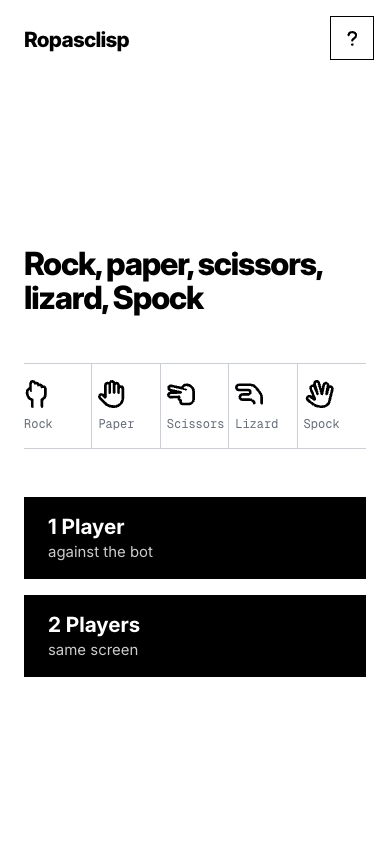 | 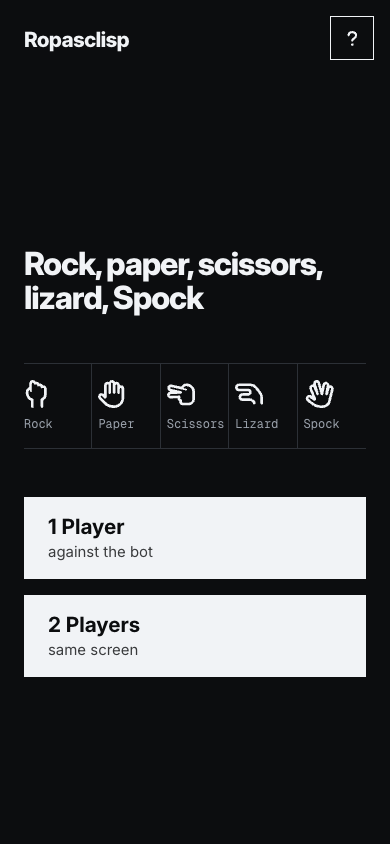 |
| Game, 390 | 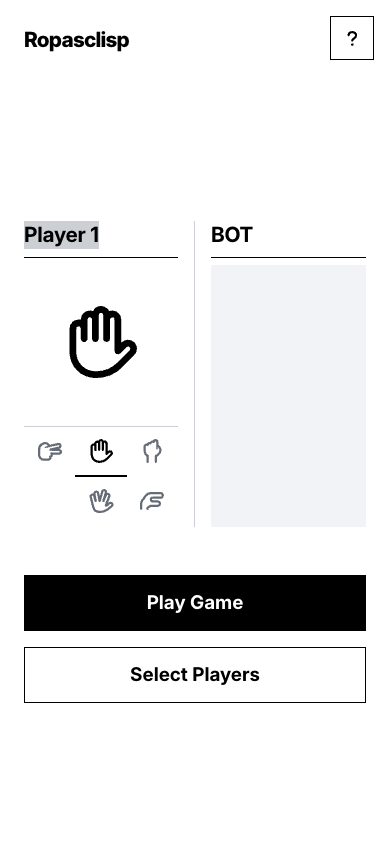 | 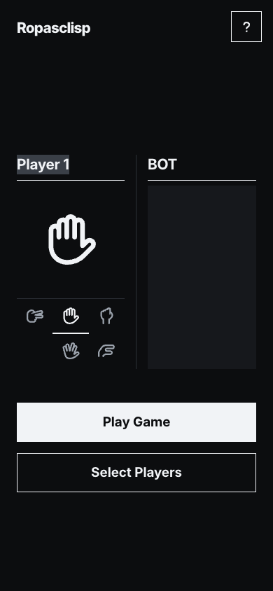 |
| Result, 390 | 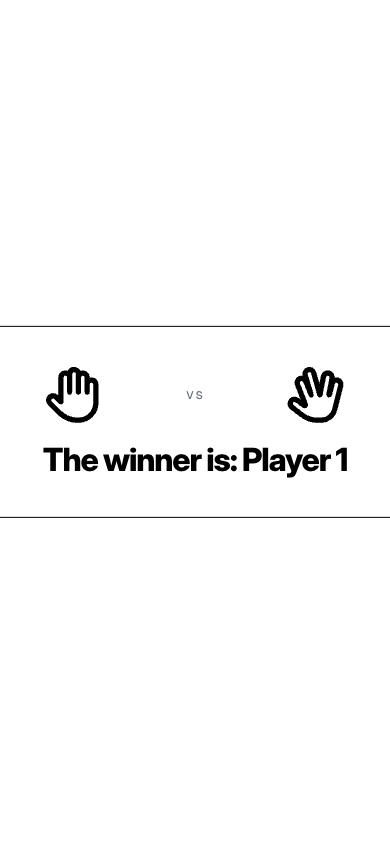 | 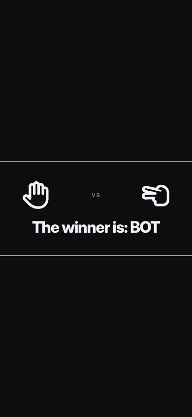 |
| Start, 1440 | 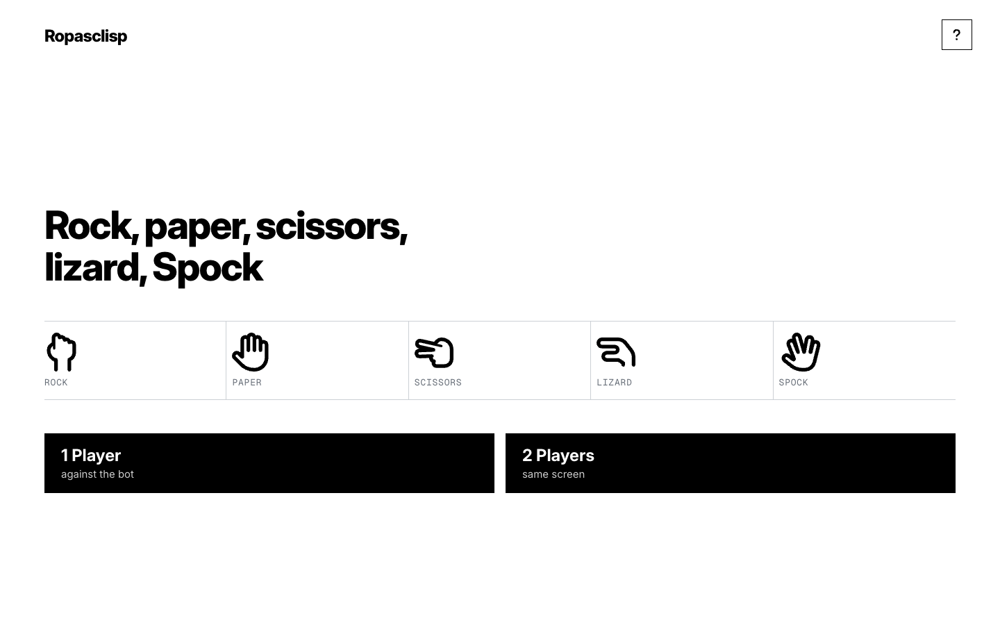 | 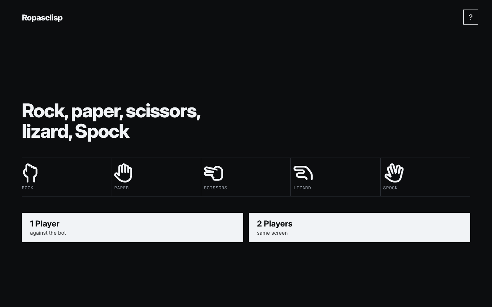 |
| Game, 1440 | 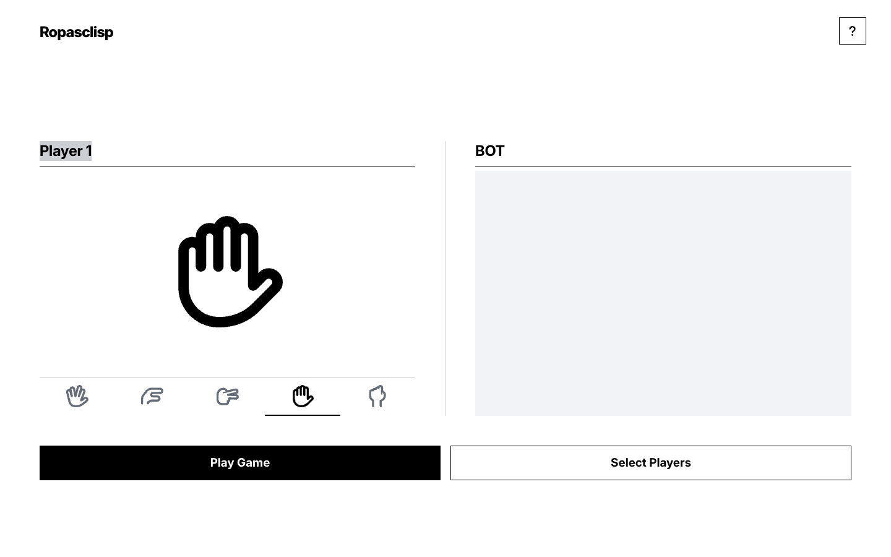 | 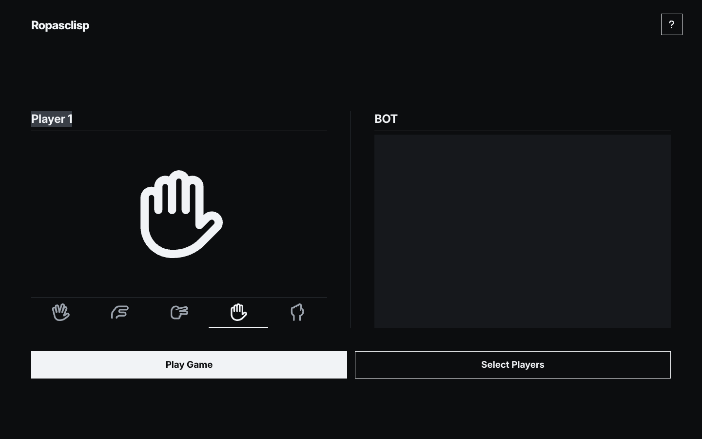 |
| Result, 1440 | 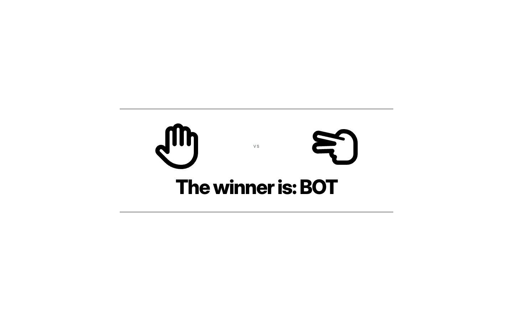 | 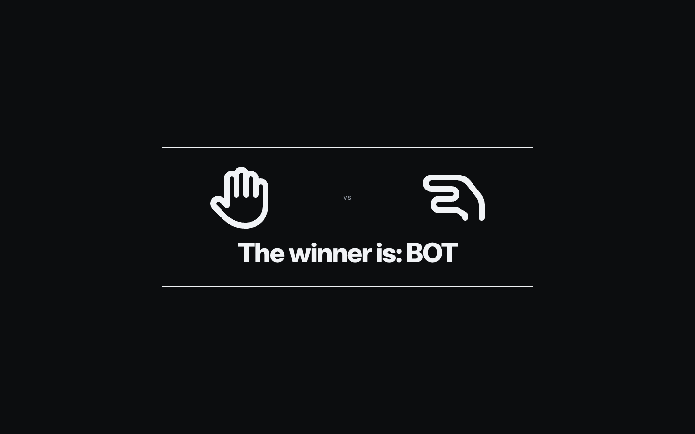 |

## Design

Colour, type and spacing come from the Kembec brand kit: `src/styles/kembec-tokens.css` is a verbatim copy of `_marca/04-sistema/design-tokens.css`, mapped into Tailwind in `tailwind.config.js`. Inter (text) and Geist Mono (labels and figures) are served from `public/fonts`.

## Technology Used

- Vue 3.4
- Vite 4
- Tailwind CSS 3

## Online Test

[Ropasclisp](https://ropasclisp.kembec.com)

## License

[GNU GPLv3](https://choosealicense.com/licenses/gpl-3.0/)